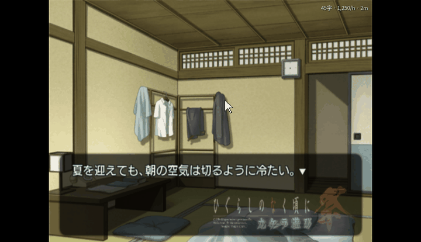
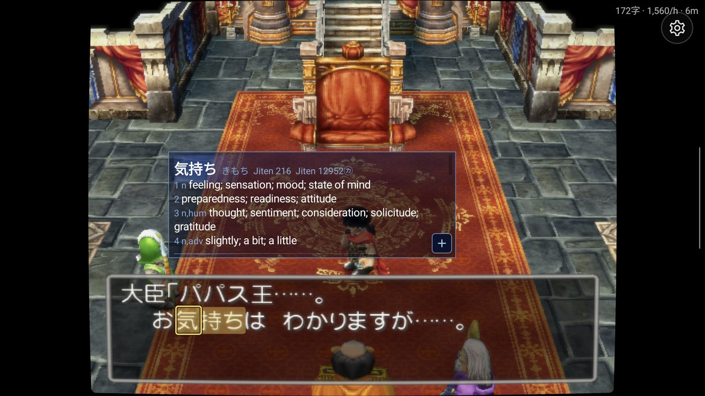
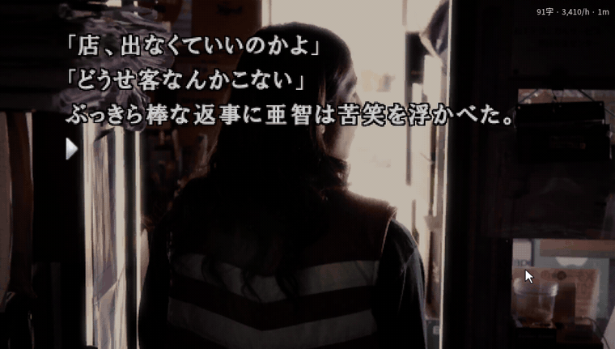
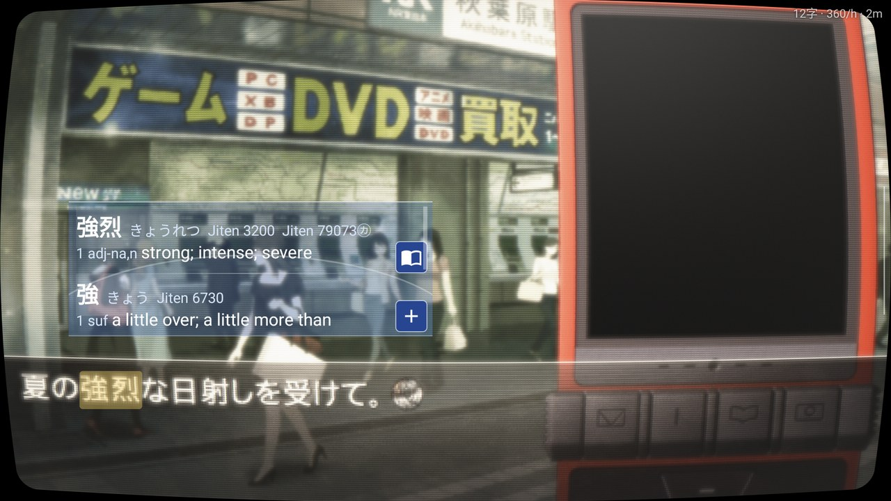
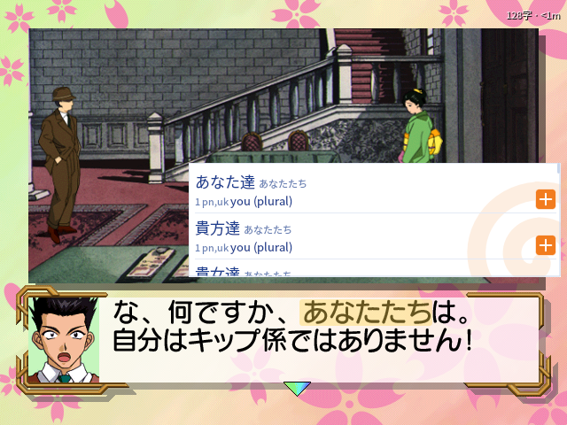

# Reader emulators

Read Japanese games like a visual novel in a browser with Yomitan: point at a word in the
game's own text and its dictionary entry opens. Make Anki cards with the sentence and a
picture of the scene, keep a backlog and reading statistics.

Four emulators have this reading layer, each in a repository of its own:

| Reader | Console | Windows | Android | Games | Download |
| --- | --- | --- | --- | --- | --- |
| [PCSX2 Reader](https://github.com/sommepo/pcsx2-reader) | PS2 | ✓ | | [11](#ps2-pcsx2-reader-and-armsx2-reader) | [zip](https://github.com/sommepo/pcsx2-reader/releases/latest) |
| [ARMSX2 Reader](https://github.com/sommepo/armsx2-reader) | PS2 | | ✓ | [11](#ps2-pcsx2-reader-and-armsx2-reader) | [APK](https://github.com/sommepo/armsx2-reader/releases/latest) |
| [PPSSPP Reader](https://github.com/sommepo/ppsspp-reader) | PSP | ✓ | ✓ | [5](#psp-ppsspp-reader) | [zip, APK](https://github.com/sommepo/ppsspp-reader/releases/latest) |
| [Flycast Reader](https://github.com/sommepo/flycast-reader) | Dreamcast | ✓ | ✓ | [7](#dreamcast-flycast-reader) | [zip, APK](https://github.com/sommepo/flycast-reader/releases/latest) |

**Windows**: unpack the zip and start the program in it. **Android**: install the APK
(arm64); it installs beside the original emulator. You need your own games (and for the PS2,
your own BIOS).

## Looking words up

- **On a computer**, point at a word. Clicking it works too.
- **On Android**, move the cursor onto a word with the controller. On a handheld with two
  screens (such as the AYN Thor) the lower screen is a trackpad for the cursor. Touching a
  word works too.

The word looked up is **outlined, and the outline glides** from word to word as you move along
the line (or highlighted, or not marked: a setting). The popup stands right next to the word and
stays put on the way to its **+**, which is in the bottom left of each entry (or any corner you
choose).

Dictionaries are Yomitan's. Cards go to Anki (AnkiConnect on Windows, AnkiDroid on Android).
Each app also has the console's own menu as its main screen and a CRT picture with a tube's
frame around it.

- **Play by touch** on a phone: a tap on the picture goes on, a tap on an answer picks it, and
  the controller's buttons stand in a small column at the right edge that a tab tucks away (on
  at first only on a device without controls of its own).
- **A Steam Controller's back buttons** are the reader's on Windows: pause the game to look words
  up, pause the statistics, make a card, open the backlog.

## Game scripts

A game is read through a **game script**: a small Lua file, one per game, named after the
disc's ID (`SLPM-66913.lua`, `ULJS00219.lua`, `HDR-0164.lua`). The script knows where that game
keeps the text it shows. Each frame it reads the text out of the game's memory and tells the
app what it says and where each character is on screen, so that pointing at a character finds
its word. A script holds addresses and decoding logic only, never text or data from the game.

**Installing**: the apps install scripts from a list published in each repository: *Game
scripts* in the app. It shows every game as *Not installed*, *Installed*, *Update available*
or *Your own script*, and installs, updates and removes scripts with a button; every file is
checked against the list before it is used. New games and fixes reach the apps through the
list, without a new app release. A script of your own can be installed from a file. The two
PS2 apps share one list, PCSX2 Reader's.

**Writing one**: a script begins with lines the apps show:

```lua
-- reader: title 北へ。White Illumination
-- reader: reads The message window: what is said and told in the story
-- reader: version T14301M (Japan)
```

Each repository's guide ("Adding a game") explains how a game is run without a display while
its script is written, and each game's notes say how its text was found. Pull requests with
new scripts are welcome, in the repository of the emulator the game runs in.

## PS2: PCSX2 Reader and ARMSX2 Reader

<table>
  <tr>
    <td width="50%"><br><sub>Windows: point at a word</sub></td>
    <td width="50%"><br><sub>Android, two screens: the lower one is a trackpad</sub></td>
  </tr>
  <tr>
    <td><br><sub>A lookup on Windows</sub></td>
    <td><br><sub>Android, one screen: touch a word</sub></td>
  </tr>
  <tr>
    <td><br><sub>The PS2 Browser: a book marks a supported game</sub></td>
    <td><br><sub>CRT picture</sub></td>
  </tr>
</table>

| Game | ID | Reads |
| --- | --- | --- |
| ひぐらしのなく頃に祭 カケラ遊び | SLPM-66913 | Story text, speakers, furigana |
| Ever17 -the out of infinity- Premium Edition | SLPM-65421 | Story text, speakers, choices |
| Remember11 -the age of infinity- | SLPM-65550 | Story text, speakers, choices |
| Never7 -the end of infinity- | SLPS-25256 | Story text, speakers, choices |
| アマガミ | SLPS-25918 | Message window, furigana, choices |
| CLANNAD | SLPM-66302 | Story text, speakers, choices; routes can be marked |
| ドラゴンクエストV 天空の花嫁 | SLPM-65555 | Message window, speakers |
| サイレントヒル2 | SLPM-65051 | Scene text and descriptions |
| EVE burst error PLUS | SLPM-65320 | Message window |
| うたわれるもの 散りゆく者への子守唄 | SLPS-25679 | Message window, speakers |
| シャドウハーツ | SLPS-25041 | Message windows, speakers |

## PSP: PPSSPP Reader

<table>
  <tr>
    <td width="50%"><br><sub>Windows: point at a word</sub></td>
    <td width="50%"><br><sub>Android, two screens: the lower one is a trackpad</sub></td>
  </tr>
  <tr>
    <td><br><sub>A lookup on Windows</sub></td>
    <td><br><sub>Android, one screen: touch a word</sub></td>
  </tr>
  <tr>
    <td><br><sub>The XMB</sub></td>
    <td><br><sub>CRT picture</sub></td>
  </tr>
</table>

| Game | ID | Reads |
| --- | --- | --- |
| 428 ～封鎖された渋谷で～ | ULJS00219 | Story text, furigana, TIPS, choices |
| STEINS;GATE | ULJM05887 | Message window, speakers, furigana, phone mails |
| CHAOS;HEAD らぶChu☆Chu! | ULJM05821 | Message window, furigana |
| D.C.I&II P.S.P., disc 1 (D.C.P.S.) | ULJM05718 | Message window, speakers, furigana, choices |
| D.C.I&II P.S.P., disc 2 (D.C.II P.S.) | ULJM05719 | Message window, speakers, furigana, choices |

## Dreamcast: Flycast Reader

<table>
  <tr>
    <td width="50%"><br><sub>Windows: point at a word</sub></td>
    <td width="50%"><br><sub>Android, two screens: the lower one is a trackpad</sub></td>
  </tr>
  <tr>
    <td><br><sub>A lookup on Windows</sub></td>
    <td><br><sub>Android, one screen: touch a word</sub></td>
  </tr>
  <tr>
    <td><br><sub>Play: a book marks a supported game</sub></td>
    <td><br><sub>CRT picture</sub></td>
  </tr>
</table>

| Game | ID | Reads |
| --- | --- | --- |
| シェンムーII | HDR-0164 | Subtitles |
| What's シェンムー 〜湯川(元)専務をさがせ〜 | 6107179 | Subtitles |
| セガガガ | HDR-0151 | Message window |
| レンタヒーロー No.1 | HDR-0074 | Message window, speakers |
| サクラ大戦 | HDR-0072 | Message window, timed choices |
| 北へ。White Illumination | T14301M | Message window |
| 新世紀エヴァンゲリオン 綾波育成計画 | T46303M | Message window |

## About

Each reader is a fork of its emulator ([PCSX2](https://github.com/PCSX2/pcsx2),
[ARMSX2](https://github.com/ARMSX2/ARMSX2), [PPSSPP](https://github.com/hrydgard/ppsspp),
[Flycast](https://github.com/flyinghead/flycast)) and is not that emulator: please report
nothing about them to those projects. The reading layer is AI-written. Each repository has its
emulator's licence.
